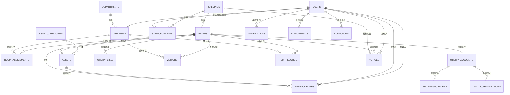

# 高校学生宿舍信息管理系统 数据库设计

| 项目 | 内容 |
|---|---|
| 文档版本 | v0.1 |
| 设计日期 | 2026-10-28 |
| 数据库 | MySQL 8.0.16+ / MySQL 26.10 |
| 字符集 | `utf8mb4` / `utf8mb4_0900_ai_ci` |
| 数据库名 | `dormitory_db` |
| 表数量 | 20 张表 + 2 个查询视图 |
| 对应脚本 | `database/schema.sql`、`database/seed.sql`、`database/reset.sql` |

> 本文是数据库设计说明，完整字段定义以 `database/schema.sql` 为准。

## 1. 设计目标

系统围绕“**楼栋 → 房间 → 住宿记录**”组织数据，支撑以下业务：

1. 学生入住、调宿、退宿，并保留完整历史；
2. 楼管按负责楼栋管理学生、房间、资产、访客和物品出入；
3. 水电工按负责楼栋处理报修、录入水电读数、生成账单；
4. 学生查看本房间信息、同楼房间电话、报修进度、水电账单和公告；
5. 舍长以学生身份发布本寝室公告；
6. 房间水电账户支持模拟充值、余额缴费和余额流水；
7. 报修照片、访客证件照、站内通知、Excel 导入导出和统计图的数据支撑。

## 2. 关键设计决策

### 2.1 账号与学生档案分离

`users` 保存登录凭证和角色，`students` 保存学号、院系、班级等学籍档案。

- 学生账号通过 `students.user_id` 关联，一个学生最多一个账号；
- 楼管、水电工、系统管理员只存在于 `users`，不建学生档案；
- 学生毕业或账号停用，不影响历史住宿、报修、访客数据。

### 2.2 住宿记录历史化

不把 `room_id` 直接放在 `students` 上，而是使用 `room_assignments`：

- 一条记录代表一段住宿经历；
- `check_out_at IS NULL` 表示当前在住；
- 调宿时关闭旧记录、创建新记录；
- 退宿只关闭记录，不物理删除。

### 2.3 一个学生只能有一条当前住宿记录

`room_assignments` 使用两个生成列：

| 生成列 | 含义 | 唯一约束 |
|---|---|---|
| `active_student_id` | 当前在住时等于 `student_id`，退宿后为 `NULL` | 一个学生只能有一条当前记录 |
| `active_bed_key` | 当前在住时为 `room_id:bed_no`，退宿后为 `NULL` | 一个床位只能住一人 |

MySQL 唯一索引允许多个 `NULL`，因此历史记录不会互相冲突。

### 2.4 多楼栋权限

- `staff_buildings` 保存员工与楼栋的负责关系；
- 一个楼管账号只绑定一栋楼，但一栋楼可以有多个楼管；
- 一个水电工可以绑定多栋楼；
- 系统管理员不绑定楼栋，拥有全局权限；
- 学生只能访问自己当前在住楼栋的数据。

这条规则由后端服务层校验；数据库保留多对多关系，便于后续调整。

### 2.5 水电“房间钱包 + 账单 + 流水”

- 每个房间一个 `utility_accounts`，保存当前余额；
- 学生/舍长/楼管发起 `recharge_orders`，模拟微信或支付宝支付；
- 每月生成一张 `utility_bills`，水费、电费合并为一张账单；
- 所有余额变化写入 `utility_transactions`，保证可追溯；
- 账单支付从余额扣减，余额不足时提示先充值，不允许负余额。

### 2.6 逻辑状态而不是物理删除

学生、房间、资产、报修、账单等使用 `status` 字段表达状态。除了附件和通知等辅助数据，不使用级联删除业务历史。

### 2.7 附件采用多态关联

`attachments` 通过 `biz_type + biz_id` 关联不同业务：

- `repair`：报修照片；
- `visitor`：访客证件照；
- `item`：物品出入照片；
- `notice`：公告附件。

文件路径只存相对路径，文件访问必须经过后端鉴权；访客证件照只允许管理员查看。

## 3. ER 图



## 4. 表清单

| 分组 | 表 | 作用 |
|---|---|---|
| 组织账号 | `departments` | 院系 |
| 组织账号 | `buildings` | 宿舍楼 |
| 组织账号 | `users` | 登录账号、角色 |
| 组织账号 | `staff_buildings` | 员工负责楼栋 |
| 住宿 | `rooms` | 房间、电话、容量、性别 |
| 住宿 | `students` | 学生档案、舍长标志 |
| 住宿 | `room_assignments` | 住宿历史、当前床位 |
| 资产报修 | `asset_categories` | 资产类别 |
| 资产报修 | `assets` | 资产台账 |
| 资产报修 | `repair_orders` | 报修单 |
| 水电 | `utility_accounts` | 房间水电账户余额 |
| 水电 | `utility_bills` | 月度水电合并账单 |
| 水电 | `recharge_orders` | 模拟充值订单 |
| 水电 | `utility_transactions` | 余额变动流水 |
| 安全事务 | `visitors` | 访客登记 |
| 安全事务 | `item_records` | 物品出入登记 |
| 安全事务 | `notices` | 楼栋/寝室公告 |
| 安全事务 | `notifications` | 站内通知 |
| 安全事务 | `attachments` | 业务附件 |
| 审计 | `audit_logs` | 关键操作日志 |
| 视图 | `v_room_occupancy` | 房间入住/空床位 |
| 视图 | `v_student_current_room` | 学生当前住宿信息 |

## 5. 核心表字段说明

### 5.1 用户与组织

#### `users`

| 字段 | 类型 | 约束/说明 |
|---|---|---|
| `id` | BIGINT UNSIGNED | 主键 |
| `username` | VARCHAR(50) | 唯一，登录名 |
| `password_hash` | VARCHAR(255) | bcrypt 哈希，绝不存明文 |
| `real_name` | VARCHAR(50) | 姓名 |
| `role` | ENUM | `sys_admin`、`building_admin`、`worker`、`student` |
| `phone` / `email` | VARCHAR | 联系方式 |
| `status` | ENUM | `active` / `disabled` |
| `last_login_at` | DATETIME | 最后登录时间 |
| `created_at` / `updated_at` | DATETIME | 时间戳 |

#### `staff_buildings`

| 字段 | 说明 |
|---|---|
| `user_id` | 员工账号 |
| `building_id` | 负责楼栋 |
| `assigned_at` | 分配时间 |

唯一键 `(user_id, building_id)`；业务层额外校验“楼管只能绑定一栋楼”。

### 5.2 学生与住宿

#### `students`

| 字段 | 类型 | 说明 |
|---|---|---|
| `id` | BIGINT UNSIGNED | 主键 |
| `user_id` | BIGINT UNSIGNED | 唯一，关联 `users`，可为空 |
| `student_no` | VARCHAR(32) | 唯一学号 |
| `name` | VARCHAR(50) | 姓名 |
| `gender` | ENUM | `male` / `female` / `other` |
| `department_id` | BIGINT UNSIGNED | 院系 |
| `class_name` | VARCHAR(100) | 班级 |
| `phone` | VARCHAR(30) | 联系电话 |
| `is_dorm_leader` | TINYINT UNSIGNED | 是否舍长，0/1 |
| `status` | ENUM | `active` / `graduated` / `suspended` |

#### `rooms`

| 字段 | 说明 |
|---|---|
| `building_id` + `room_no` | 联合唯一，房间号只在楼内唯一 |
| `floor` | 楼层 |
| `phone` | 房间电话，用于同楼查询 |
| `capacity` | 可住人数 |
| `gender` | 房间性别限制 |
| `status` | `normal` / `maintenance` / `closed` |

#### `room_assignments`

| 字段 | 说明 |
|---|---|
| `student_id` / `room_id` | 学生与房间 |
| `bed_no` | 床位号 |
| `check_in_at` | 入住时间 |
| `check_out_at` | 退宿时间，空表示当前在住 |
| `status` | `active` / `transferring` / `checked_out` |
| `active_student_id` | 生成列，当前在住学生唯一约束 |
| `active_bed_key` | 生成列，当前床位唯一约束 |

约束：

- `check_out_at >= check_in_at`；
- `checked_out` 必须有退宿时间，其他状态必须没有退宿时间；
- 调宿时旧记录 `checked_out`，新记录 `active`；
- 房间容量由服务层在事务中校验。

### 5.3 资产与报修

#### `assets`

| 字段 | 说明 |
|---|---|
| `asset_no` | 唯一资产编号，例如 `B01-101-BED-01` |
| `category_id` | 资产类别 |
| `room_id` | 所属房间 |
| `name` / `brand` | 名称、品牌规格 |
| `status` | `normal` / `repairing` / `scrapped` / `idle` |

#### `repair_orders`

| 字段 | 说明 |
|---|---|
| `order_no` | 唯一报修单号 |
| `room_id` | 报修房间 |
| `asset_id` | 报修资产，可为空 |
| `asset_name` | 未入账资产名称，`asset_id` 为空时使用 |
| `reporter_id` | 报修人用户 |
| `description` | 故障描述 |
| `priority` | `low` / `normal` / `high` / `urgent` |
| `status` | `pending` / `processing` / `completed` / `cancelled` |
| `handler_id` | 接单水电工 |
| `reported_at` / `accepted_at` / `resolved_at` | 三个关键时间 |
| `solution` / `cancel_reason` | 处理方案 / 取消原因 |

业务约束：`asset_id` 为空时必须填写 `asset_name`；`completed` 必须有 `resolved_at`。这两条由服务层校验（MySQL 26.10 对“外键列 + CHECK”有限制，未写成数据库 CHECK）。

### 5.4 水电

#### `utility_accounts`

| 字段 | 说明 |
|---|---|
| `room_id` | 唯一，一个房间一个账户 |
| `balance` | 当前余额，`DECIMAL(12,2)`，不允许负数 |
| `status` | `active` / `frozen` |

#### `utility_bills`

| 字段 | 说明 |
|---|---|
| `bill_no` | 唯一账单号 |
| `room_id` + `bill_month` | 联合唯一，一个房间每月一张账单 |
| `water_prev` / `water_curr` | 水表上期/本期读数 |
| `water_unit_price` | 水价快照 |
| `electricity_prev` / `electricity_curr` | 电表上期/本期读数 |
| `electricity_unit_price` | 电价快照 |
| `water_usage` / `electricity_usage` | 生成列，自动计算用量 |
| `water_amount` / `electricity_amount` | 生成列，自动计算金额 |
| `total_amount` | 生成列，水费 + 电费 |
| `status` | `unpaid` / `paid` / `cancelled` |
| `due_date` / `paid_at` | 截止日 / 缴费时间 |
| `generated_by` | 生成人（楼管/水电工） |

生成列公式：

```text
water_usage        = water_curr - water_prev
water_amount       = round(water_usage * water_unit_price, 2)
electricity_usage  = electricity_curr - electricity_prev
electricity_amount = round(electricity_usage * electricity_unit_price, 2)
total_amount       = water_amount + electricity_amount
```

#### `recharge_orders`

| 字段 | 说明 |
|---|---|
| `order_no` | 唯一订单号 |
| `account_id` | 水电账户 |
| `amount` | 充值金额，必须大于 0 |
| `pay_method` | `wechat_mock` / `alipay_mock` / `admin_cash` |
| `status` | `pending` / `success` / `failed` / `cancelled` |
| `created_by` / `paid_at` | 发起人 / 支付时间 |

#### `utility_transactions`

| 字段 | 说明 |
|---|---|
| `account_id` | 账户 |
| `type` | `recharge` / `bill_payment` / `adjustment` / `refund` |
| `amount` | 变动金额，充值为正，缴费为负 |
| `balance_after` | 变动后余额 |
| `biz_type` + `biz_id` | 关联充值订单/账单/手工调整 |
| `created_by` | 操作人 |

余额变更必须在同一个数据库事务中完成：

1. 锁定 `utility_accounts` 行；
2. 检查余额或校验订单状态；
3. 更新余额；
4. 写入 `utility_transactions`；
5. 更新订单/账单状态。

充值订单号唯一，重复回调不能重复加余额。

### 5.5 访客、物品、公告、通知、附件

#### `visitors`

- `host_student_id`：被访学生；
- `room_id`：被访房间；
- `visit_at` / `leave_at`：来访/离开时间；
- `status`：`visiting` / `left` / `cancelled`；
- `registered_by`：登记人；
- `id_no` 为敏感字段，列表默认脱敏，证件照仅管理员可看。

#### `item_records`

- `direction`：`in` / `out`；
- `quantity > 0`；
- `status`：`pending` / `approved` / `rejected`；
- `reviewed_by` / `reviewed_at` / `review_remark` 保存审核信息。

#### `notices`

- `scope = building` 时 `room_id` 必须为空；
- `scope = room` 时 `room_id` 必须有值；
- 楼管发布本楼公告，舍长发布本寝室公告；
- 该规则由服务层校验。

#### `notifications`

- 按用户生成通知；
- `is_read` 0/1；
- 关键事件：报修状态变化、物品审核、账单生成、充值成功、公告发布；
- 前端先采用轮询刷新，不引入 WebSocket。

#### `attachments`

- `biz_type` + `biz_id` 关联业务；
- 只存相对路径，不存公开 URL；
- 上传时校验扩展名、MIME、大小；
- 访客证件照下载必须鉴权。

## 6. 状态机

### 6.1 住宿

```text
未入住 --管理员分配--> 已入住(active)
已入住 --学生申请/管理员审核--> 调宿中(transferring)
调宿中 --完成调整--> 已入住(active，新记录)
调宿中 --取消--> 已入住(active，原记录)
已入住 --毕业/退宿--> 已退宿(checked_out)
```

### 6.2 报修

```text
待受理(pending) --水电工接单--> 维修中(processing)
维修中 --填写解决时间/方案--> 已办结(completed)
待受理/维修中 --取消--> 已取消(cancelled)
```

按现有课程设计图，采用“水电工直接接单”，楼管保留查看、催办、改派能力。

### 6.3 水电账单 / 充值

```text
账单：未缴(unpaid) --余额支付--> 已缴(paid)
账单：未缴 --作废--> 已取消(cancelled)
充值：待支付(pending) --模拟支付成功--> 成功(success)
充值：待支付 --失败/取消--> failed / cancelled
```

## 7. 角色权限矩阵

| 功能 | 系统管理员 | 楼管 | 水电工 | 学生/舍长 |
|---|---|---|---|---|
| 账号、楼栋、院系 | 全部 | 只读本楼 | 只读本楼 | 无 |
| 学生、住宿 | 全部 | 本楼增改/调宿/退宿 | 只读 | 只看自己 |
| 房间、资产 | 全部 | 本楼管理 | 本楼只读 | 本房间只读 |
| 报修 | 全部 | 本楼查看/催办/改派 | 本楼接单/办结 | 本房间报修 |
| 水电账单 | 全部 | 本楼查看 | 本楼抄表/生成 | 本房间查看 |
| 充值 | 全部 | 本楼代充 | 本楼查看 | 本房间充值 |
| 访客 | 全部 | 本楼查询 | 无 | 本房间登记 |
| 物品出入 | 全部 | 本楼审核 | 无 | 本房间登记 |
| 公告 | 全部 | 本楼发布 | 查看 | 舍长发布本寝室 |

后端必须按 `staff_buildings` 和当前住宿记录过滤数据，不能只靠前端隐藏菜单。

## 8. 索引说明

| 索引 | 目的 |
|---|---|
| `uk_users_username` | 登录名唯一 |
| `uk_students_student_no` | 学号唯一 |
| `uk_rooms_building_room_no` | 同一楼内房间号唯一 |
| `uk_assign_active_student` | 一个学生只有一条当前住宿 |
| `uk_assign_active_bed` | 一个床位只住一人 |
| `uk_assets_asset_no` | 资产编号唯一 |
| `uk_utility_bills_room_month` | 一个房间每月一张账单 |
| `uk_recharge_orders_no` | 充值订单幂等 |
| `idx_repair_status_time` | 按状态和报修时间查询 |
| `idx_visitors_room_time` | 按房间和来访时间查询 |
| `idx_notifications_user_read` | 未读通知列表 |
| `idx_attachments_biz` | 按业务查附件 |

## 9. 安全与隐私

1. 密码只存 bcrypt 哈希；JWT 密钥、数据库密码放 `.env`，不提交 Git。
2. MySQL 使用专用账号 `dorm_app`，只授权 `dormitory_db.*`，不直接使用 root 运行后端。
3. `visitors.id_no` 列表脱敏；证件照仅管理员可下载。
4. 附件存放在非公开目录，通过鉴权接口读取；不要直接暴露 `uploads/` 静态目录。
5. 公开 GitHub 仓库禁止提交 `.env`、数据库密码、JWT 密钥、真实学生信息。
6. 所有写接口做参数校验和角色/楼栋校验；使用 ORM 参数化查询，避免 SQL 注入。
7. 关键操作写入 `audit_logs`，便于答辩展示和问题追踪。

## 10. 初始化与演示数据

### 10.1 初始化

```bash
mysql -u root -p < database/schema.sql
mysql -u root -p < database/seed.sql
```

### 10.2 重置开发库

```bash
mysql -u root -p < database/reset.sql
mysql -u root -p < database/schema.sql
mysql -u root -p < database/seed.sql
```

`reset.sql` 会删除所有业务表和数据，只用于本地开发。

### 10.3 当前演示数据

- 院系：4 个；
- 楼栋：3 栋；
- 房间：10 间；
- 资产类别：6 类；
- 资产：9 件；
- 水电账户：10 个；
- 登录账号：**不预置**，避免在公开仓库中存放默认密码。

管理员账号建议由后端初始化脚本读取环境变量创建，或首次启动时生成随机密码并打印到控制台。

## 11. 已知限制与后续扩展

1. **MySQL 26.10 Innovation 版**：开发可用；如果驱动或 Workbench 出现兼容问题，可切换到 MySQL 8.4 LTS。
2. **水电账单采用固定水/电两列**：满足当前“账单合并”的需求；如果后续增加热水、空调费等，可拆出 `utility_bill_items`。
3. **房间容量未做数据库触发器**：分房时由服务层在事务中校验容量，避免并发超住。
4. **公告范围、报修资产二选一**：由服务层校验，原因是 MySQL 26.10 对“外键列 + CHECK”存在限制。
5. **Docker**：后期补 `docker-compose.yml`，数据库账号通过环境变量注入。
6. **Excel 导入导出**：表结构已预留 `departments`、`class_name`、`rooms`、`room_assignments` 等字段，后续实现模板校验和错误回传。

## 12. 变更记录

| 日期 | 变更 |
|---|---|
| 2026-10-28 | 初版：完成 20 张表、2 个视图、住宿历史、水电钱包/账单/流水、访客/物品/公告/通知/附件设计 |
