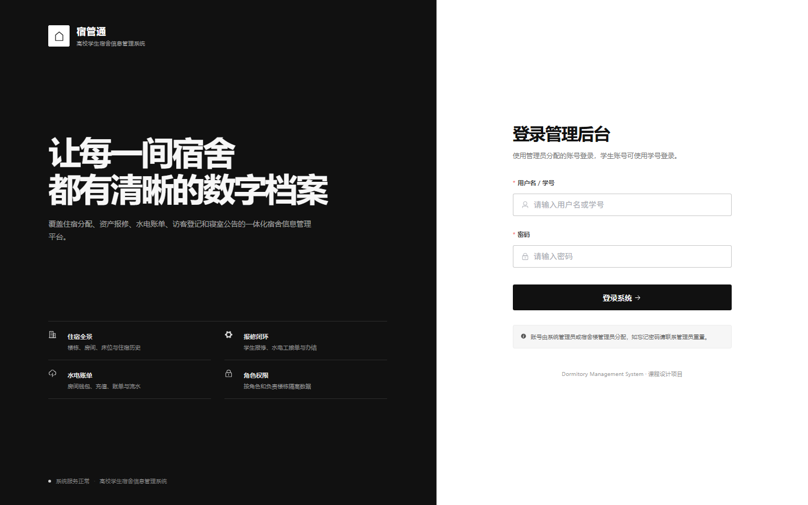
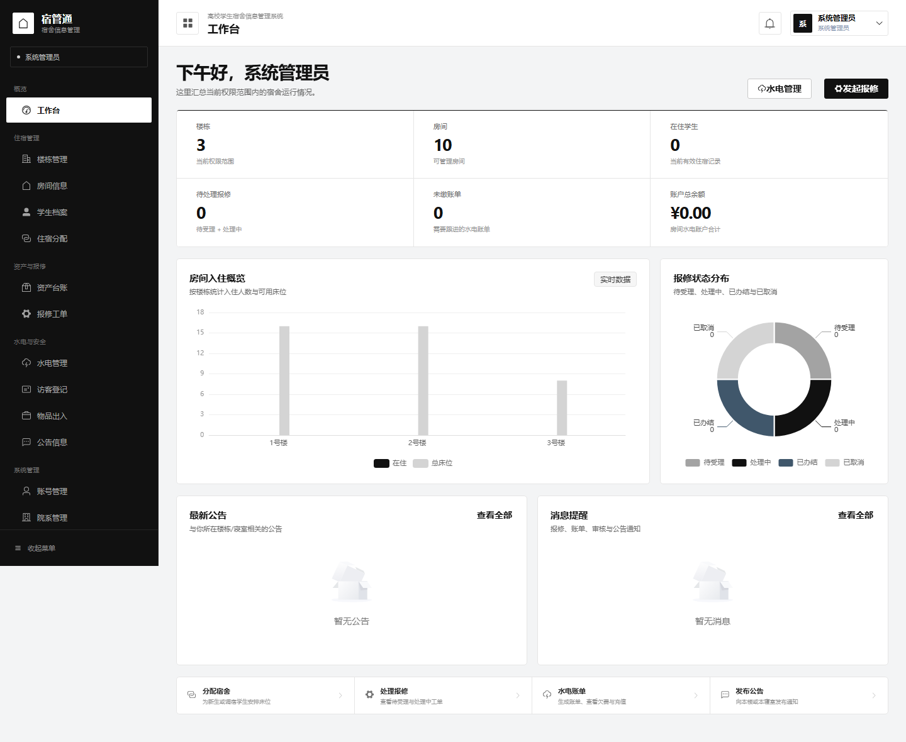
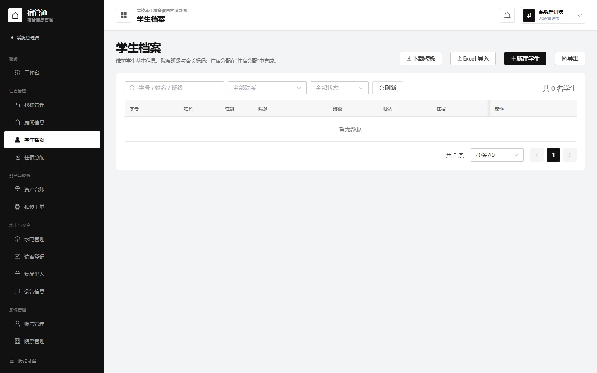
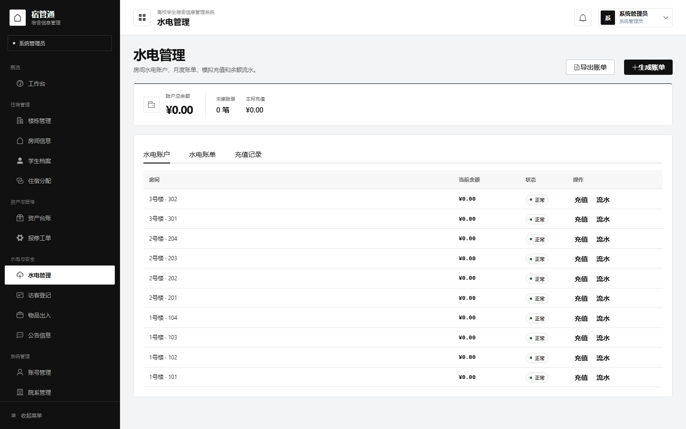

# 前端设计与实现说明

| 项目 | 内容 |
|---|---|
| 技术栈 | Vue 3 + Vite + JavaScript + Vue Router + Pinia + Element Plus + Axios + ECharts |
| 开发地址 | `http://127.0.0.1:5173` |
| API 代理 | `/api` → `http://127.0.0.1:8000` |
| 代码目录 | `frontend/src` |
| 设计主题 | 冷灰 + 黑 + 白，参考 Hallmark 的 Ink / Grid 材质 |

## 1. 页面预览

### 登录页



### 工作台



### 学生档案



### 水电管理



### 设计参考：Hallmark

本次视觉调整参考了 GitHub 上的 [Nutlope/hallmark](https://github.com/Nutlope/hallmark)（约 4.1 万 Star）。它不是一套现成 UI 模板，而是一份“拒绝 AI 味”的前端设计约束，核心做法是：先选材质，再按任务组织页面，并用可检查的门禁约束颜色、排版和留白。

从中复用的原则：

1. **材质优先**：白色纸张、无彩度黑色、灰色细线、非常克制的冷调强调色；不使用装饰性渐变、彩色光晕和厚重卡片阴影。
2. **去掉 AI 感套路**：不再每个标题上方放一个全大写英文 eyebrow，不使用 tracked capitals，不在标题里单独染一个词，不用一排空框充当内容。
3. **结构为任务服务**：统计数字用一条横向 hairline 分栏，列表和表格优先于卡片瀑布；页面收束在真正的操作上。
4. **只保留一个强调色**：冷钢蓝 `#40576b` 只用于焦点、链接 hover、必要状态；黑色才是主操作色。
5. **细节克制**：3–5px 小圆角、1px 边框、几乎无阴影；靠字重、字号、留白和细线建立层级。

参考主题主要是 **Ink**（白纸、无彩黑、hairline rules、单一色只表示状态）和 **Grid**（列节奏、少盒子、0–4px 圆角），少量借用了 **Vantage** 的冷暗色仪表感。

## 2. 工程结构

```text
frontend/
├─ index.html
├─ vite.config.js            # 代理 /api 到 FastAPI
├─ package.json
├─ public/favicon.svg
└─ src/
   ├─ main.js                # Vue、Pinia、Router、Element Plus
   ├─ App.vue
   ├─ api/
   │  ├─ http.js             # Axios 实例、JWT、错误处理、文件下载
   │  └─ index.js            # 业务 API 封装
   ├─ stores/auth.js         # 登录态、用户、学生档案、角色
   ├─ router/
   │  ├─ index.js            # 路由与权限守卫
   │  └─ menu.js             # 按角色过滤的菜单
   ├─ layouts/MainLayout.vue # 侧边栏、顶栏、通知、用户菜单
   ├─ components/
   │  ├─ PageHeader.vue
   │  ├─ StatCard.vue
   │  ├─ StatusTag.vue
   │  └─ AttachmentPanel.vue # 报修照片上传/下载
   ├─ views/
   │  ├─ login/
   │  ├─ dashboard/
   │  ├─ system/             # 账号、院系
   │  ├─ building/           # 楼栋、房间
   │  ├─ student/            # 学生、住宿分配、我的宿舍
   │  ├─ asset/              # 资产台账
   │  ├─ repair/             # 报修工单
   │  ├─ utility/            # 水电账户/账单/充值
   │  ├─ security/           # 访客、物品出入
   │  ├─ notice/             # 公告、通知
   │  ├─ profile/
   │  └─ error/
   └─ utils/constants.js     # 标签、颜色、格式化
```

## 3. 登录与权限

### 登录流程

1. 登录页调用 `POST /auth/login`；
2. 成功后保存 `access_token` 和用户信息到 `localStorage`；
3. 学生账号额外调用 `GET /students/me`，获取宿舍和舍长标记；
4. `router.beforeEach` 校验 token、加载用户信息、检查路由 `meta.roles`；
5. Axios 请求拦截器自动添加 `Authorization: Bearer <token>`；
6. 401 时清除本地登录态并跳转登录页。

### 菜单权限

| 菜单 | 系统管理员 | 楼管 | 水电工 | 学生 |
|---|---|---|---|---|
| 工作台 | ✓ | ✓ | ✓ | ✓ |
| 楼栋管理 | ✓ | ✓（只读） | ✓（只读） | — |
| 房间信息 | ✓ | ✓ | ✓ | ✓（本楼） |
| 学生档案 | ✓ | ✓ | ✓（只读） | — |
| 住宿分配 | ✓ | ✓ | — | — |
| 我的宿舍 | — | — | — | ✓ |
| 资产台账 | ✓ | ✓ | ✓（只读） | — |
| 报修工单 | ✓ | ✓ | ✓ | ✓ |
| 水电管理 | ✓ | ✓ | ✓ | ✓ |
| 访客/物品/公告 | ✓ | ✓ | ✓ | ✓ |
| 账号/院系 | ✓ | — | — | — |

权限不只靠前端隐藏：所有数据范围仍由后端按角色和 `staff_buildings` / 当前住宿过滤。

## 4. 页面功能

| 页面 | 功能 |
|---|---|
| 登录 | 用户名/学号 + 密码登录、错误提示、登录态持久化 |
| 工作台 | 角色化统计卡片、入住概览柱状图、报修状态饼图、最新公告、消息、快捷入口 |
| 账号管理 | 列表、搜索、新建/编辑、角色标签、重置密码、绑定负责楼栋 |
| 院系管理 | 院系列表、新建/编辑 |
| 楼栋管理 | 楼栋列表、性别限制、状态；管理员可编辑 |
| 房间信息 | 楼栋/关键词/状态筛选、空床位、房间电话、新建/编辑 |
| 学生档案 | 学生列表、院系/状态筛选、新建/编辑、Excel 导入/导出、创建学生账号 |
| 住宿分配 | 分配、调宿、退宿、状态筛选、导出 |
| 我的宿舍 | 当前房间、床位、房间电话、水电余额、公告、快捷入口 |
| 资产台账 | 资产类别、房间、状态筛选、新建/编辑 |
| 报修工单 | 学生报修、水电工接单/办结、取消、详情抽屉、报修照片上传/下载、导出 |
| 水电管理 | 账户、账单、充值记录三个 Tab；生成账单、模拟充值、余额缴费、账户流水、导出 |
| 访客登记 | 登记、离开、取消、导出 |
| 物品出入 | 学生登记、楼管审核通过/驳回 |
| 公告信息 | 楼管楼栋公告、舍长寝室公告、归档 |
| 消息通知 | 全部/未读筛选、标记已读、全部已读、未读数 |
| 个人中心 | 账号信息、学生档案、修改密码 |
| 错误页 | 403 / 404 |

## 5. 设计系统

- 页面底色：`#f3f4f5`（冷灰纸面）；
- 主墨色：`#111111`；次级文字 `#6b6b6b`；弱化文字 `#969696`；
- 分割线：`#e5e5e5`；强分割线：`#111111` 只用在统计区或列表起始；
- 强调色：`#40576b`（冷钢蓝），只用于焦点、链接 hover 和少量状态；
- 侧边栏：`#111111` 黑底；当前菜单为白底黑字，不使用彩色填充；
- 表面：白纸 + 1px 边框，圆角 3–5px，静止状态不投影；只有对话框保留轻投影；
- 字体：Segoe UI / PingFang SC / Microsoft YaHei；靠字号、字重和留白分层，不使用全大写 tracked 标签；
- 统计：用一条顶部黑线 + hairline 分栏，而不是一排独立彩色卡片；
- 状态：`StatusTag` 使用中性描边胶囊 + 5px 状态点，状态色降低饱和度；
- 图表：黑、灰、冷钢蓝单色阶，不使用高饱和多色；
- 登录页：左侧纯黑品牌区 + 右侧白纸表单，去除渐变、光斑和大圆角；
- 表单：两列表单栅格，移动端自动单列；
- 响应式：960px 以下侧边栏变为抽屉式覆盖。

### 视觉关键词

`paper` · `ink` · `hairline` · `flat` · `cool grey` · `restrained accent` · `editorial spacing`

## 6. API 封装

`src/api/http.js` 负责：

- baseURL：`/api/v1`；
- JWT 注入；
- 401 统一跳转登录；
- 后端 `detail` 字符串/数组/对象错误统一转换为可读提示；
- Excel 文件流下载和文件名解析。

`src/api/index.js` 按业务模块封装：

- `authApi`
- `dashboardApi`
- `userApi`
- `departmentApi` / `buildingApi` / `roomApi`
- `studentApi` / `assignmentApi`
- `assetApi` / `repairApi`
- `utilityApi`
- `visitorApi` / `itemApi` / `noticeApi` / `notificationApi`
- `attachmentApi` / `excelApi`

## 7. 本地运行

```bash
cd frontend
npm install
npm run dev
```

前端：<http://127.0.0.1:5173>  
后端需同时运行在 `http://127.0.0.1:8000`。

生产构建：

```bash
npm run build
npm run preview
```

## 8. 当前完成度

- [x] 登录、JWT 持久化、角色路由守卫
- [x] 主布局、菜单、通知入口、用户下拉
- [x] 工作台统计与 ECharts 图表
- [x] 账号/院系/楼栋/房间/学生/住宿
- [x] 资产/报修/水电/访客/物品/公告/通知
- [x] 学生 Excel 导入、学生/住宿/报修/账单/访客导出
- [x] 学生账号创建、个人中心
- [x] 登录页、工作台、学生档案、水电页面截图验收
- [x] 按 Hallmark 的冷灰/黑白/细线方向重构视觉系统
- [ ] 宿舍分配 Excel 导入的前端入口（后端接口已具备）
- [ ] 访客证件照上传 UI（后端接口已具备）
- [ ] 更细的移动端适配和 ECharts 按需加载
- [ ] Docker/Nginx 部署
